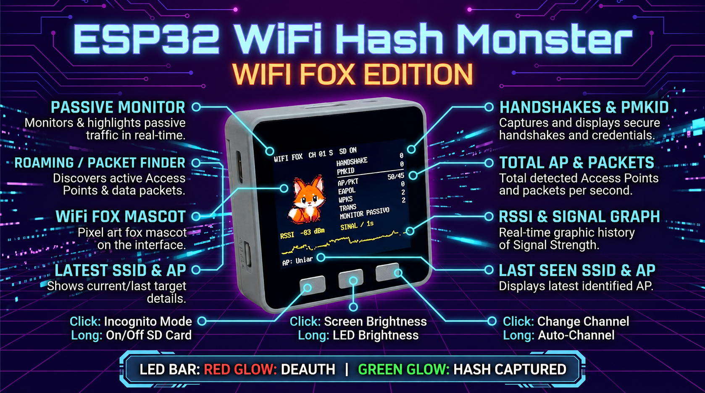

# Fox WiFi

<p align="center">
    <a href="https://github.com/Jimmyheay/Fox_Wifi/blob/main/LICENSE"></a>
    <a href="https://github.com/Jimmyheay/Fox_Wifi/graphs/contributors"></a>
</p>

Fox WiFi passively records 802.11 packets to a microSD card on M5Stack and ESP32 hardware.

Most of the code is based on the excellent [PacketMonitor32](https://github.com/spacehuhn/PacketMonitor32/) by &nbsp; <a href="https://twitter.com/intent/follow?screen_name=spacehuhn"></a>, together with the [M5Stack](https://m5stack.com/) port by [macsbug](https://macsbug.wordpress.com/2018/01/11/packetmonitor32-with-m5stack/). The project explores how a compact ESP32 device can present network-monitoring information inspired by [Pwnagotchi](https://github.com/evilsocket/pwnagotchi) <a href="https://twitter.com/intent/follow?screen_name=pwnagotchi"></a>.



When a Wi-Fi client connects to a WPA2-PSK access point, the devices exchange four EAPOL messages as part of the four-way handshake. Fox WiFi records observed EAPOL and PMKID-related traffic for authorized, offline analysis.

Fox WiFi captures EAPOL and PMKID observations to the microSD card for later analysis.

Short-press the first button to enable Incognito mode, which turns off the display and LEDs. Long-press it to enable or disable microSD storage for captured EAPOL and PMKID traffic.

Short-press the second button to change the display backlight brightness. Long-press it to change the LED bar brightness.

Short-press the third button to change the Wi-Fi channel. Long-press it to select **Auto-Channel** or **Smart-Channel** mode.

**Auto-Channel** cycles through channels 1 through 13 every 15 seconds.

**Smart-Channel** scans all channels in sequence, changing channels only when no new SSID, EAPOL, or deauthentication frame is observed for 15 seconds.

The display uses the compact fox atlas above. Sixteen 64×64 poses are packed at
4 bits per pixel in firmware flash and streamed at 2× scale without allocating a
128×128 framebuffer. The editable source sheet remains in `assets/fox`; run
`node tools/build_fox_assets.js` after changing it.


## WiFi Fox dashboard

The M5Stack screen uses a 128×128 direct-drawn fox, a compact metrics panel and
one yellow RSSI history graph. The previous green packet graph and its buffers
were removed to leave more display and RAM available for monitoring.

The passive analyzer records EAPOL message classes, completed four-way handshake
observations, PMKID KDE records, WPA3/SAE advertisements, WPA2/WPA3 transition
mode and PMF capability. It does not inject frames, alter authentication, or try
passwords. The WPA3 and PMF indicators describe observed advertisements; they do
not prove that an access point is secure.

Host-side parser checks can be run with:

```sh
g++ -std=c++11 -Wall -Wextra -Werror -IESP32-WiFi-Hash-Monster \
  ESP32-WiFi-Hash-Monster/SecurityAnalyzer.cpp tests/security_analyzer_test.cpp \
  -o /tmp/security_analyzer_test && /tmp/security_analyzer_test
```

## M5Stack Core2

`m5stack-core2` is the default PlatformIO environment. The dashboard forces the
Core2 display into 320×240 landscape, uses Chimera-Core's Core2 display and
button API, and keeps passive monitoring active when no microSD card is present.
Without a card, capture storage is disabled until the SD control is enabled;
screen metrics and channel controls remain available.

Build it with:

```sh
pio run -e m5stack-core2
```

The M5Stack Fire environment remains available as `m5stack-fire`.

The project pins current compatible releases of LovyanGFX 1.2.35,
ESP32-Chimera-Core 1.5.2 and M5Stack-SD-Updater 1.2.8 in `platformio.ini`.


# Capture workflow

Use these commands only with networks and capture files that you are authorized to assess.

## Convert PCAP

```sh
tshark -r 0006.pcap -w 0006_novo.pcapng -F pcapng
sudo hcxpcapngtool -o hash_total2.txt 0006_novo.pcapng
```

## Inspect EAPOL

```sh
tshark -r 0006.pcap -Y "eapol"
```

## Convert for Hashcat

```sh
hcxpcapngtool -o hash_total.txt arquivo_captura.pcapng
```

## Hashcat

```sh
hashcat -m 22000 -a 0 hash_total.txt /usr/share/wordlists/rockyou.txt
```

## Hashcat — 8 digits

```sh
hashcat -m 22000 -a 3 01-hash/hash_total.txt "?d?d?d?d?d?d?d?d"
```


